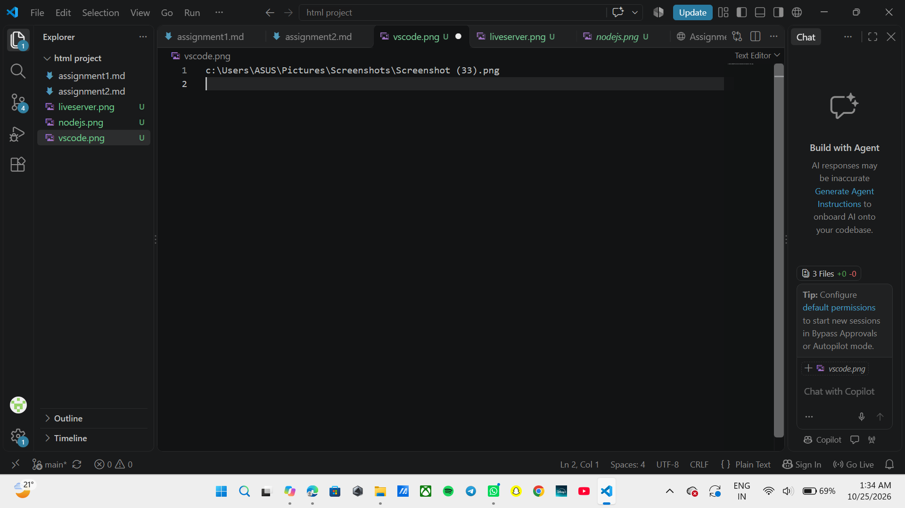
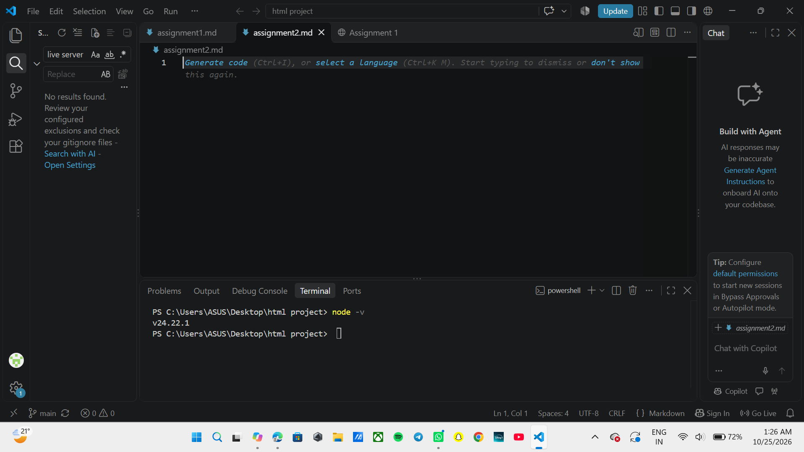
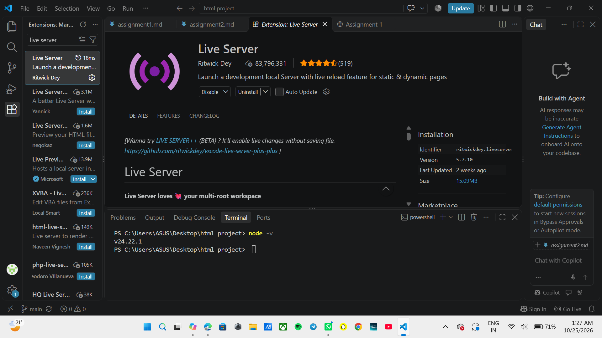

Assignment 2 :"Submit a screenshot proving VS Code, Node.js, and Live Server are installed correctly"

Software Verification

The following software was installed and verified successfully:

1. Visual Studio Code
Visual Studio Code was installed and opened successfully.

2. Node.js
Node.js was installed and verified using the command.

node -v.
 3. Live Server

The Live Server extension was installed in Visual Studio Code and is available for running HTML pages locally.
